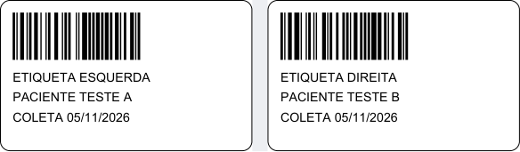
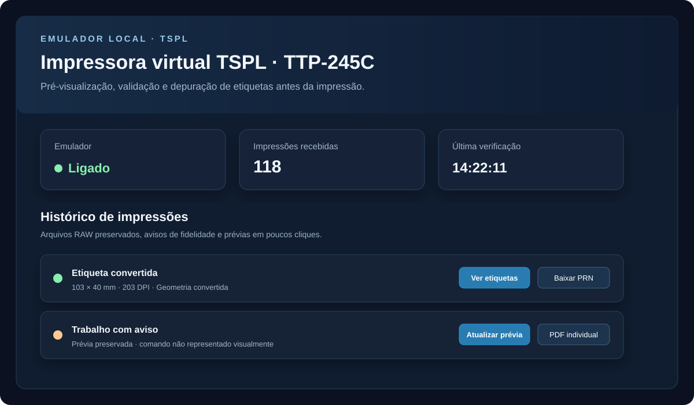

<div align="center">

# TSC Label Printer Emulator

### A virtual TSC DA300 printer for testing, previewing and debugging TSPL labels on Windows.

Capture RAW **TSPL/TSPL2** print jobs locally and turn them into accurate PDF, PNG and SVG previews — without needing the physical printer.

<p>
  <a href="https://github.com/Mathsto19/tsc-label-printer-emulator/releases">Releases</a>
  &nbsp;&bull;&nbsp;
  <a href="LEIA-ME.md">Full documentation (Português)</a>
</p>

</div>

<div align="center">



</div>

<div align="center">



</div>

## Why this project?

When a system prints directly to a label printer, it is difficult to inspect the exact TSPL commands, layout, spacing and barcode positioning without consuming labels or having the printer connected.

This project provides a local virtual printer queue named **`TSC DA300`**. It receives RAW print jobs, preserves the original `.prn` bytes and generates a visual preview so you can validate the result before printing on physical media.

## Features

- Virtual Windows printer queue compatible with RAW printing.
- TCP receiver restricted to `127.0.0.1`.
- PDF previews with the exact paper size from the TSPL `SIZE` command.
- PNG and SVG previews for quick inspection.
- Original `.prn` files preserved for debugging and reproduction.
- Web panel with print history, warnings and preview controls.
- Support for 203 DPI layouts and native 300 DPI mode.
- Configurable printer alignment profile.
- Optional QZ Tray integration for browser-based printing.
- Portable Windows package with bundled Python runtime.
- No internet connection required during normal operation.

## Supported TSPL commands

The emulator currently supports:

`SIZE` · `GAP` · `REFERENCE` · `SHIFT` · `DIRECTION` · `CODEPAGE` · `CLS` · `PRINT` · `TEXT` · `BARCODE` · `BAR` · `BOX` · `CIRCLE` · `BITMAP` · `QRCODE`

Unsupported or partially supported commands generate visible warnings in the panel instead of silently producing a misleading result.

## Quick start

### Portable package — recommended

1. Download the latest package from [Releases](https://github.com/Mathsto19/tsc-label-printer-emulator/releases).
2. Extract the complete ZIP to a permanent folder.
3. Run `INSTALAR_IMPRESSORA.bat` as administrator.
4. Run `INICIAR_SIMULADOR.bat` normally.
5. Open the panel at <http://127.0.0.1:8767/>.
6. Select the Windows queue named **`TSC DA300`** in your application.

The portable package targets **Windows 10/11 x64** and includes the required Python runtime and libraries.

### Send a sample job manually

With the simulator running, execute this PowerShell snippet from the project folder:

```powershell
$dados = [System.IO.File]::ReadAllBytes((Resolve-Path '.\exemplo_teste.prn'))
$cliente = [System.Net.Sockets.TcpClient]::new('127.0.0.1', 19100)
$fluxo = $cliente.GetStream()
$fluxo.Write($dados, 0, $dados.Length)
$fluxo.Flush()
$cliente.Close()
```

The generated files will appear in the panel and in the local `Saidas` folder.

## Development setup

Requires **Python 3.12**.

```powershell
python -m venv .venv
.\.venv\Scripts\Activate.ps1
python -m pip install -r requirements.txt
python simulador.py
```

To run the test suite:

```powershell
python -m pytest testes
```

To generate a new portable package:

```powershell
powershell.exe -NoProfile -ExecutionPolicy Bypass -File .\preparar_pacote.ps1
```

## Important limitations

This is a **software simulator**, not a USB device emulator. It does not provide:

- Physical USB identifiers or USB hardware discovery.
- Complete bidirectional printer status.
- Proprietary driver emulation.
- Automatic conversion from PDF, HTML or GDI output to TSPL.
- Perfect firmware-level rendering for every font, bitmap mode or barcode variant.

For the complete compatibility list, troubleshooting guide, calibration details and security notes, see [`LEIA-ME.md`](LEIA-ME.md).

## Privacy and local data

The simulator listens only on localhost and does not transmit print data over the internet. Captured jobs, PDFs and previews are saved locally and may contain sensitive information. Restrict access to the project folder and remove test outputs when they are no longer needed.

## License

This project is licensed under the [MIT License](LICENSE).

<div align="center">

Made for safer and faster label-printing tests.

</div>
